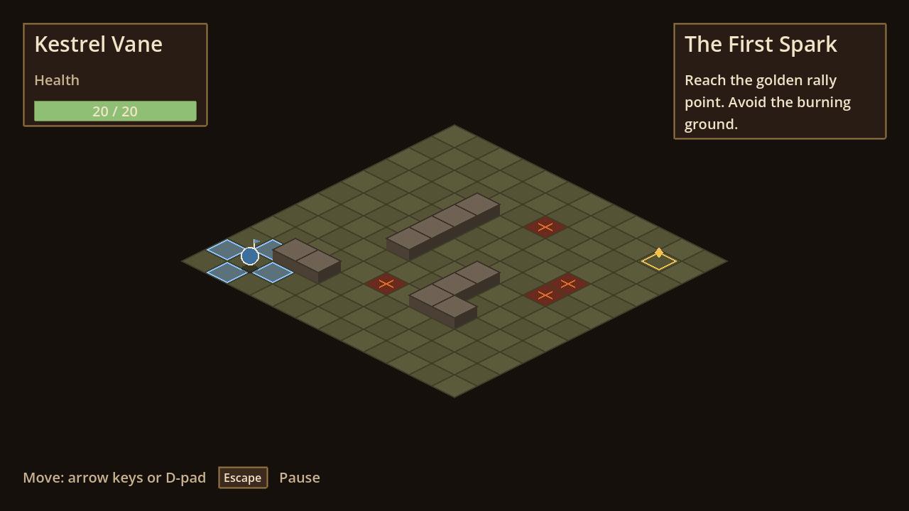
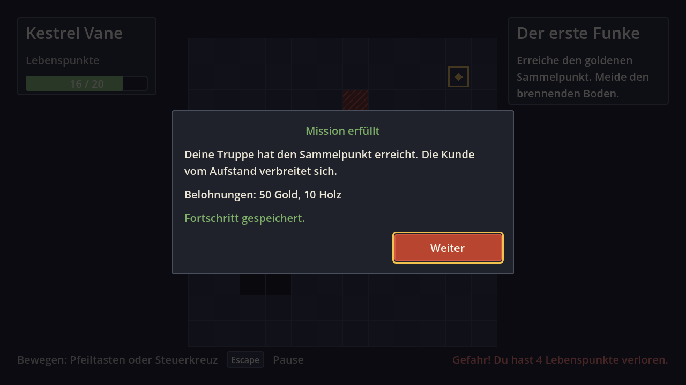
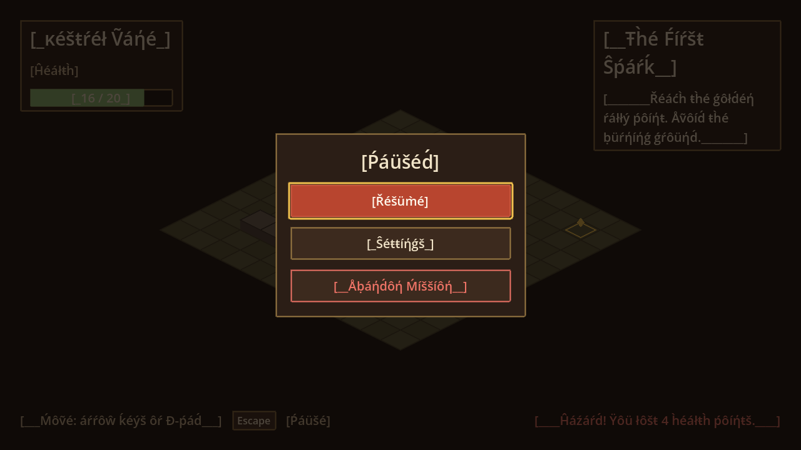
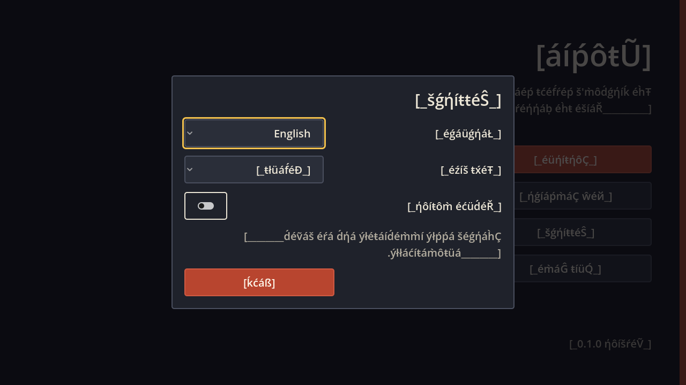

# Utopia

A tactical single-player RPG: a former soldier uncovers a kingdom's dark
secret and builds a revolutionary army. Deck-driven battles on
Fire-Emblem-sized grids, freely combinable hero + battalion units, base
building, scouting, and a soul-energy system that decides between liberation
and tyranny. Design: [`docs/game-design/mechanics-and-core-loop.md`](docs/game-design/mechanics-and-core-loop.md).

**Status: initial architecture, placeholder art.** The project boots, shows a localized main
menu, and plays a minimal mission (move one unit across a 12×12 isometric grid, avoid
hazards, reach the objective, autosave). Card play, enemies, and the base are
not built yet — see "Blueprint coverage" in [`docs/ARCHITECTURE.md`](docs/ARCHITECTURE.md).

| | |
|---|---|
| Engine | Godot 4.6 **.NET** (≥ 4.5 required), C# / .NET 8 |
| Renderer | GL Compatibility, 2D |
| Platforms | Windows, Linux |
| Languages | English (source), German |


## Getting started

1. Install [Godot 4.6 **.NET**](https://godotengine.org/download) and the
   [.NET 8 SDK](https://dotnet.microsoft.com/download) (Linux: `bash tools/setup/install_toolchain.sh`).
2. Open `project.godot` in the editor and press Play, or from a terminal:
   ```bash
   dotnet build                     # compile the C# (the editor does this on Play)
   godot --path . --import          # first time only
   godot --path .                   # run the game
   godot --path . -- --route=gameplay   # debug builds: jump straight into a mission
   ```
3. Controls: arrow keys / D-pad move, Esc / Start pauses, Enter/Space/A
   confirm, Esc/B back.

## Tests

```bash
python3 tools/guards/check_rules.py                     # rule guards (seconds)
GODOT=/path/to/godot-mono tests/run_tests.sh            # everything CI runs
godot --headless --path . res://tests/framework/test_runner.tscn -- --filter=save
```

186 Godot tests (unit + integration, C#), 25 Python automation-client tests,
10 guard-script tests, an end-to-end automation scenario, boot smoke runs,
translation key extraction, and a locale screenshot tool. See
[`docs/TESTING.md`](docs/TESTING.md). CI: `.github/workflows/ci.yml` (PRs and
`main`); the full suite with renderer and screenshots runs every night
(`.github/workflows/nightly.yml`).

## How this game is built

The owner describes features in plain language and judges them by playing.
Claude Code directs (plans, asks, writes briefs, reviews); Codex workers build;
the model that wrote something never reviews it. Repeated mistakes become
rules and guard scripts. See [`docs/AI_WORKFLOW.md`](docs/AI_WORKFLOW.md), the
rulebook [`docs/AI_INSTRUCTIONS.md`](docs/AI_INSTRUCTIONS.md), and
[`AGENTS.md`](AGENTS.md).

## Remote automation (dev/QA builds)

AI agents, CI, and tools can inspect and drive the running game through a
secure local JSON-RPC protocol (HTTP + WebSocket): stable entity ids, state,
semantic actions, real keyboard/mouse/gamepad input, waits, assertions,
fixtures, screenshots. Python SDK, CLI, and MCP adapter in `tools/automation/`.

```bash
PYTHONPATH=tools/automation python3 -m utopia_automation scenario first_mission --godot $GODOT --project . --headless
```

See [`docs/AUTOMATION.md`](docs/AUTOMATION.md).

## Project layout

```
addons/ assets/ autoload/ core/ features/ scenes/ networking/ shaders/ automation/ tools/ tests/ docs/
```

Explained in [`docs/ARCHITECTURE.md`](docs/ARCHITECTURE.md).

## Documentation

| Doc | Topic |
|---|---|
| [ARCHITECTURE](docs/ARCHITECTURE.md) | Layers, autoloads, runtime flow, coverage, limitations |
| [ART_DIRECTION](docs/ART_DIRECTION.md) | Confirmed target art direction, references, benchmarks |
| [VISUAL_QUALITY_RUBRIC](docs/VISUAL_QUALITY_RUBRIC.md) | Weighted rubric, scores, state matrix, readiness, improvement plan |
| [ART_IMPLEMENTATION_GUIDE](docs/ART_IMPLEMENTATION_GUIDE.md) | Pixel grid, palette, naming, import, budgets, review process |
| [UI_STYLE_GUIDE](docs/UI_STYLE_GUIDE.md) | Game UI look: materials, HUD priority, cards, buttons, never-list |
| [SCENE_TREE_RULES](docs/SCENE_TREE_RULES.md) | Scene ownership, node references, lifetimes |
| [SIGNALS_AND_EVENTS](docs/SIGNALS_AND_EVENTS.md) | Signal contracts and input actions |
| [RESOURCES](docs/RESOURCES.md) | Data Resources and content |
| [SAVE_SYSTEM](docs/SAVE_SYSTEM.md) | Save format, backends, migrations |
| [UI_ARCHITECTURE](docs/UI_ARCHITECTURE.md) | Screens, buttons, theme, accessibility |
| [LOCALIZATION](docs/LOCALIZATION.md) | Keys, catalogs, formatting, adding languages |
| [ANIMATION_AND_MOVEMENT](docs/ANIMATION_AND_MOVEMENT.md) | Movement/animation audit |
| [COLLISION_AND_HIT_DETECTION](docs/COLLISION_AND_HIT_DETECTION.md) | Collision audit |
| [TESTING](docs/TESTING.md) | Test runner and coverage |
| [ADDING_A_FEATURE](docs/ADDING_A_FEATURE.md) | Step-by-step recipe |
| [AUTOMATION](docs/AUTOMATION.md) | Remote automation protocol, security, SDK, CI |
| [AI_INSTRUCTIONS](docs/AI_INSTRUCTIONS.md) | The rulebook for AI assistants and contributors |
| [AI_WORKFLOW](docs/AI_WORKFLOW.md) | Roles, briefs, cross-model review, nightly tests, art & sound pipeline |
| [MISTAKES](docs/MISTAKES.md) | Repeated mistakes and the rule or guard each produced |
| [decisions/](docs/decisions/) | Architecture decision records |

## Screenshots

Captured with `tests/tools/screenshot_capture.tscn` (English, German,
pseudolocalized, right-to-left):

| | |
|---|---|
|  |  |
|  |  |
